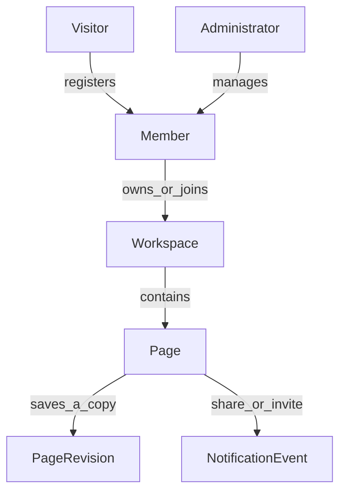

# Domain model

This description is about the ideas in NoteKeeper. It does not depend on PostgreSQL, MongoDB, or Java.

## Actors

- Visitor: a person who is not signed in.
- Member: a signed-in person. The system role is USER, EDITOR, or ADMIN.
- Workspace owner: the person who created a workspace.
- Workspace collaborator: a person added to a workspace as OWNER, EDITOR, or VIEWER.
- Administrator: a member whose system role is ADMIN.

## Processes

1. Register and sign in. Sign-in can use a password or Google. A verification code is sent by email.
2. Create a workspace. The creator becomes the owner and receives an Inbox workspace by default.
3. Write a page inside a workspace. A page can be favorited, archived, tagged, and given a cover.
4. Share a page or invite a workspace member. The owner chooses the role or permission.
5. Notify the other person. The notification can be an email, an SMS record, or an in-app event.
6. Review older copies of a page. Each save can keep a document copy of the title and content.

## Data objects

- User: name, username, email, phone, system role.
- Profile: bio, avatar, theme, language.
- Location: a place in a province, district, sector, cell, or village hierarchy.
- Workspace: name, icon, owner, whether it is the default inbox.
- Membership: the link between a user and a workspace, plus the workspace role.
- Page: title, content, author, workspace, favorite flag, archive flag.
- Tag: a label that can be attached to many pages.
- Attachment: a file stored for a page.
- Page share: a direct grant for one person to view or edit one page.
- Notification: an in-app message.
- Page revision: a saved copy of a page at one moment.
- Delivery log: a record that an email, SMS, or app event was handed to the message broker.

## Relationships

- One user owns many workspaces.
- One workspace has many members, and one user can belong to many workspaces.
- One workspace contains many pages.
- One page has one author and can have many tags.
- One page can be shared with many users.
- One page can have many revisions.
- One user can have many notifications and many delivery-log entries.

