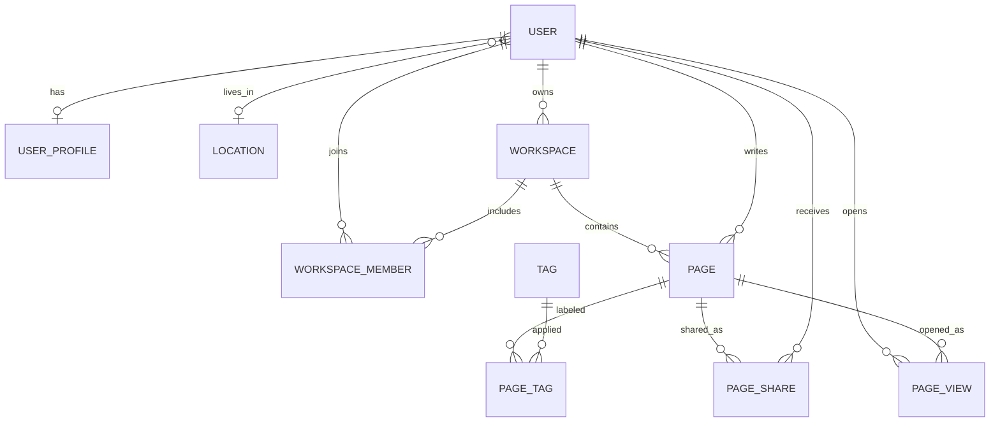

# Physical schema

Operational data stays in PostgreSQL. Document data stays in MongoDB. The Docker stack creates a new PostgreSQL database on host port 5433. It does not connect to the existing database on port 5432.

## PostgreSQL

Primary keys are UUID strings. Foreign keys are the `*_id` columns below. Unique columns already create indexes. Extra lookup indexes for the Docker database are listed where a foreign key is used in list and permission checks.

### users

- `id` primary key
- `username` unique, not null
- `email` unique, not null
- `password` not null
- `role` system role: USER, ADMIN, or EDITOR
- `phone_number` optional, used as the SMS recipient
- `location_id` foreign key to `locations.id`
- Index: unique index on `email` and `username`

### user_profiles

- `id` primary key
- `user_id` foreign key to `users.id`, one profile per user

### locations

- `id` primary key
- `code` unique
- `parent_id` foreign key to `locations.id`

### workspaces

- `id` primary key
- `owner_id` foreign key to `users.id`, not null
- `is_default` marks the Inbox workspace
- Index: `owner_id`

### workspace_members

- `id` primary key
- `workspace_id` foreign key to `workspaces.id`
- `user_id` foreign key to `users.id`
- `role` one of OWNER, EDITOR, VIEWER
- Index: `workspace_id`, `user_id`

### pages

- `id` primary key
- `user_id` foreign key to `users.id`, not null
- `workspace_id` foreign key to `workspaces.id`, not null
- `title` not null
- `content` text
- `is_favorite`, `is_archived` not null
- Index: `workspace_id`, `user_id`

### tags

- `id` primary key
- `name` unique

### page_tags

- `id` primary key
- `page_id` foreign key to `pages.id`
- `tag_id` foreign key to `tags.id`

### page_shares

- `id` primary key
- `page_id` foreign key to `pages.id`
- `shared_by` foreign key to `users.id`
- `shared_with` foreign key to `users.id`
- `permission` VIEW or EDIT

### page_views

One row per person and page: the last time that person opened the page. It drives Recent history. Columns are plain ids with no foreign keys, so a deleted page or user never blocks a write. Rows for a deleted page are removed with the page.

- `id` primary key
- `user_id` the person who opened the page
- `page_id` the page that was opened
- `last_viewed_at` time of the latest open
- Index: unique on (`user_id`, `page_id`), and (`user_id`, `last_viewed_at`) for the newest-first list

### system_settings

Switches the administrator controls from the dashboard Settings tab. One row per setting.

- `setting_key` primary key: `allowRegistration`, `defaultRole`, `requireTwoFactor`, `emailNotifications`, `smsNotifications`
- `setting_value` text
- A missing row means the default: sign-up on, default role USER, two-factor on, email on, SMS on.

### attachments

- `id` primary key
- `page_id` foreign key to `pages.id`

### notifications

- `id` primary key
- `user_id` foreign key to `users.id`

### two_factor_codes and password_reset_tokens

- `id` primary key
- `user_id` foreign key to `users.id`
- Token or code value, plus an expiry time

## MongoDB

Database name: `notekeeper`. These collections are written only when the application starts with the `docker` profile.

### page_revisions

- `pageId` string, the PostgreSQL page id
- `title` string
- `content` string
- `workspaceId` string
- `authorId` string
- `savedAt` timestamp
- Index: `pageId`

### delivery_logs

- `channel` one of `email`, `sms` or `app`
- `recipient` string (an e-mail address, a phone number, or the event name for `app`)
- `body` string (for `email` only the subject is kept, because e-mail bodies can contain sign-in codes and reset links)
- `recordedAt` timestamp
- Index: `channel`

## RabbitMQ

Durable queues:

- `email` — verification codes, password resets, and share emails. A worker sends them through the existing SMTP mail sender, then records a delivery log entry (subject only).
- `sms` — text messages. A worker writes them to `delivery_logs`. No external SMS provider is called.
- `app-events` — events such as `page-shared` and `workspace-shared`. A worker writes them to `delivery_logs`.

The local profile, used by `mvn spring-boot:run`, does not open these queues. Email in that profile is still sent directly. The assignment demo uses Docker, where there is no direct-send bypass.
