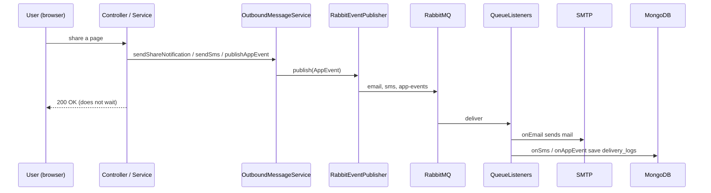

# NoteKeeper architecture deep dive (assessment preparation)

This document explains how the project is built, file by file, and answers the
questions a senior developer is likely to ask. Everything here was read from the
source, not assumed. Where the project has a limit, it says so.

Contents:

1. The one-minute summary
2. Run modes: the most important thing to understand
3. RabbitMQ: where, why, and how
4. MongoDB: where, why, and how
5. What stays in PostgreSQL
6. Request lifecycle and layers
7. Security: JWT, RBAC, 2FA, Google OAuth2
8. Frontend structure
9. Testing, CI and Docker
10. Requirement-to-code map
11. Honest limitations (say these before they are found)
12. Likely questions and answers
13. How to demonstrate it live

---

## 1. The one-minute summary

NoteKeeper is a note-taking web app. People keep **pages** inside **workspaces**
and share them with roles (OWNER, EDITOR, VIEWER).

| Layer | Technology |
| --- | --- |
| Frontend | React 18 (Create React App), React Router 7, Tailwind CSS, lucide-react icons, axios |
| Backend | Spring Boot 3.5.7, Java 17, Spring Security, Spring Data JPA, Spring AMQP, Spring Data MongoDB |
| Relational data | PostgreSQL (all business data) |
| Document data | MongoDB (page history, delivery log) |
| Messaging | RabbitMQ (email, SMS, app events) |
| Auth | JWT (HS256, 10 h), BCrypt, 2FA e-mail code, Google OAuth2 |
| Packaging | Docker Compose: postgres, mongo, rabbitmq, backend, frontend |
| Tests | JUnit 5, Mockito, MockMvc on H2 (backend); Jest and React Testing Library (frontend) |

---

## 2. Run modes: the most important thing to understand

The app has **two run modes**, chosen by the Spring profile.

| | Local mode (`mvn spring-boot:run`) | Docker mode (`docker compose up`, profile `docker`) |
| --- | --- | --- |
| PostgreSQL | `localhost:5432/notekeeper_db` | `postgres:5432/notekeeper` (host port 5433) |
| RabbitMQ | **not used** | used |
| MongoDB | **not used** | used |
| Event publisher | `DirectEventPublisher` | `RabbitEventPublisher` |
| Page history recorder | `NoOpPageRevisionRecorder` | `MongoPageRevisionRecorder` |

If you run `npm run dev` and `mvn spring-boot:run` on your laptop, **RabbitMQ and
MongoDB are not involved at all**. They only exist in the Docker stack. Say this
clearly, and demonstrate with Docker.

How the switch works, in `NotekeeperApplication.java`:

```java
@SpringBootApplication(exclude = {
    RabbitAutoConfiguration.class,
    MongoAutoConfiguration.class,
    MongoDataAutoConfiguration.class,
    MongoRepositoriesAutoConfiguration.class
})
```

Spring Boot's auto-configuration for Rabbit and Mongo is switched **off**, so a
local run never tries to connect to a broker or a database that is not there.
`config/DockerInfrastructureConfig.java` is annotated `@Profile("docker")` and
creates the same beans by hand (Mongo client and template, queues, connection
factory, JSON converter, `RabbitTemplate`, listener container factory).

Each feature is written as an **interface with two implementations**, one per
profile. That is the strategy pattern, selected by `@Profile`:

| Interface | `docker` profile | `!docker` profile |
| --- | --- | --- |
| `EventPublisher` | `RabbitEventPublisher` | `DirectEventPublisher` |
| `PageRevisionRecorder` | `MongoPageRevisionRecorder` | `NoOpPageRevisionRecorder` |

The rest of the code depends only on the interface, so no service contains
`if (docker)`.

---

## 3. RabbitMQ: where, why, and how

### 3.1 The files

| File | Role |
| --- | --- |
| `messaging/AppEvent.java` | The message. Fields: `type`, `recipient`, `subject`, `body`. Factory methods `email()`, `sms()`, `app()`. `queueName()` maps the type to a queue. |
| `messaging/EventPublisher.java` | Interface with one method, `publish(AppEvent)`. |
| `messaging/RabbitEventPublisher.java` | `rabbitTemplate.convertAndSend(event.queueName(), event)`. Docker only. |
| `messaging/DirectEventPublisher.java` | Local only. Sends e-mail directly through `EmailService`. For `sms` and `app` events it only logs. |
| `messaging/OutboundMessageService.java` | The one class the rest of the app calls. It builds the message text and checks the admin switches. |
| `messaging/QueueListeners.java` | The consumers (`@RabbitListener`). Docker only. |
| `config/DockerInfrastructureConfig.java` | Declares the three durable queues, the `RabbitTemplate`, and the JSON converter. |
| `docker-compose.yml` | The `rabbitmq:3-management` container (ports 5672 and 15672). |
| `src/main/resources/application-docker.properties` | `spring.rabbitmq.host=rabbitmq`, port `5672`. |

### 3.2 The three queues

All three are durable (`new Queue(name, true)`).

| Queue | Event type | Consumer method | What the consumer does |
| --- | --- | --- | --- |
| `email` | `email` | `QueueListeners.onEmail` | Calls `EmailService.sendEmail` (SMTP), then saves a `DeliveryLog` (channel `email`, subject only). |
| `sms` | `sms` | `QueueListeners.onSms` | Saves a `DeliveryLog` document in MongoDB (channel `sms`). No real SMS provider. |
| `app-events` | `app` | `QueueListeners.onAppEvent` | Saves a `DeliveryLog` document in MongoDB (channel `app`). |

Messages are converted to JSON by `Jackson2JsonMessageConverter`.

### 3.3 What triggers a message

Every producer goes through `OutboundMessageService`.

| Trigger | Where in the code | Messages produced |
| --- | --- | --- |
| Login with 2FA on | `AuthController.login` | `email` (6-digit code) |
| Resend 2FA code | `AuthController.send-2fa` | `email` |
| Google sign-in (2FA) | `AuthController.google-callback` | `email` |
| Forgot password | `AuthController.forgot-password` | `email` (reset link) |
| Invite someone to a workspace | `WorkspaceInvitationController.invite` | `email`, `sms` (if the person has a phone), `app-events` (`workspace-invited`) |
| Share a page | `PageShareService.sharePage` | `email`, `sms`, `app-events` (`page-shared`) |
| Add a workspace member directly | `WorkspaceMemberService.addMember` | `email`, `sms`, `app-events` (`workspace-shared`) |

### 3.3a RabbitMQ and SMTP do not conflict

They sit at different layers. RabbitMQ is the **internal hand-off** between the web
request and a background worker. SMTP is the **delivery protocol** the worker uses to
give the mail to Gmail. The flow is request, then RabbitMQ `email` queue, then
`QueueListeners.onEmail`, then SMTP, then the person's inbox. RabbitMQ never replaces
SMTP; it decides when and in which thread SMTP is called. In local mode there is no
queue, so `DirectEventPublisher` calls SMTP straight from the request.

In Docker, the SMTP credentials reach the backend through `docker-compose.yml`
(`SMTP_USERNAME` and `SMTP_PASSWORD`, read from the `.env` file next to it).

### 3.3b SMS when a person has no phone number

`OutboundMessageService.sendSms` returns without publishing anything when the number
is null or blank. No event, no queue message, no log entry, and no error. The e-mail
and the app event for the same action are still sent. SMS is also skipped when the
admin turns SMS off. SMS is never really delivered: the `sms` worker only records it in
`delivery_logs`.

### 3.3c Why the queues need `RabbitAdmin`

Spring Boot's Rabbit auto-configuration is excluded, and that is what normally creates
the `RabbitAdmin` bean that declares queues on the broker. `DockerInfrastructureConfig`
therefore declares `RabbitAdmin` itself. Without it the queues never exist and the
listeners stop with `NOT_FOUND - no queue 'sms'`.

### 3.4 Admin switches that affect messaging

`SystemSettingService` stores the settings in the `system_settings` table.

- Share and invitation e-mails are skipped when **emailNotifications** is off.
- SMS is skipped when **smsNotifications** is off, or the phone number is blank.
- Security e-mails (2FA code, password reset) are **never** skipped.

This is covered by `OutboundMessageServiceTest`.

### 3.5 Why RabbitMQ here

- **Decoupling:** the HTTP request returns without waiting for SMTP. SMTP can take seconds or fail.
- **Fan-out of side effects:** a share creates an e-mail, an SMS and an event. The service publishes them and does not know how they are delivered.
- **Durability:** queues are durable, so a message waits if the consumer is restarting.
- **Swappable delivery:** replacing the simulated SMS with a real provider only changes `QueueListeners.onSms`.



---

## 4. MongoDB: where, why, and how

### 4.1 The files

| File | Role |
| --- | --- |
| `document/PageRevision.java` | `@Document("page_revisions")`. A snapshot of a page at save time. |
| `document/DeliveryLog.java` | `@Document("delivery_logs")`. A record of an SMS or app event. |
| `repository/mongo/PageRevisionRepository.java` | Spring Data Mongo repository. |
| `repository/mongo/DeliveryLogRepository.java` | Spring Data Mongo repository. |
| `messaging/PageRevisionRecorder.java` | Interface: `record(Page)`. |
| `messaging/MongoPageRevisionRecorder.java` | Saves a `PageRevision`. Docker only. |
| `messaging/NoOpPageRevisionRecorder.java` | Does nothing. Local only. |
| `config/DockerInfrastructureConfig.java` | `MongoClient`, `MongoTemplate` (database `notekeeper`), `@EnableMongoRepositories`. |

### 4.2 The two collections

**`page_revisions`**: one new document **every time a page is saved**.

| Field | Meaning |
| --- | --- |
| `pageId` (indexed) | Id of the page in PostgreSQL |
| `title`, `content` | Snapshot at save time |
| `workspaceId`, `authorId` | Ids of the workspace and the author |
| `savedAt` | Timestamp |

It is written from `PageService`, in three places: `createPage`,
`createQuickNote`, and `updatePage`. Each calls `pageRevisionRecorder.record(saved)`
right after the PostgreSQL save.

**`delivery_logs`**: one document per message consumed from RabbitMQ.

| Field | Meaning |
| --- | --- |
| `channel` (indexed) | `email`, `sms` or `app` |
| `recipient` | E-mail address, phone number, or the event name for app events |
| `body` | Message text (for `email` only the subject, because bodies hold codes and links) |
| `recordedAt` | Timestamp |

Written only by `QueueListeners` (`onEmail`, `onSms`, `onAppEvent`). So **MongoDB
depends on RabbitMQ** for this collection: the queue is the producer, MongoDB is the sink.

### 4.2a The read screen

Admins have **MongoDB Data** in the sidebar (route `/admin/data`, file
`pages/admin/DataStore.jsx`). It calls `MongoInsightsController`:

| Endpoint | Returns |
| --- | --- |
| `GET /api/admin/mongo/status` | `available` flag and the document count of each collection |
| `GET /api/admin/mongo/page-revisions?limit=&pageId=` | newest revisions, with a text preview |
| `GET /api/admin/mongo/page-revisions/{id}` | one revision with its full content |
| `GET /api/admin/mongo/delivery-logs?limit=&channel=` | newest log entries, filter by channel |

All of them sit under `/api/admin/**`, so only ADMIN can call them. In local mode the
Mongo repositories do not exist, so the controller answers `available: false` and the
screen explains that MongoDB is Docker-only. No cluster or account is needed: MongoDB
is the `mongo` container. MongoDB Compass can connect to `mongodb://127.0.0.1:27017` (use `127.0.0.1`, not `localhost`: on Windows `localhost` can resolve to IPv6 `::1`, which WSL holds). The compose file also starts **mongo-express** at http://localhost:8081.

### 4.3 Why MongoDB here (the design argument)

- A page revision is a **self-contained snapshot**. It is read as a whole and never joined to other tables.
- The history is **append-only** and grows with every save. Keeping it out of PostgreSQL keeps the operational tables small.
- A delivery log has a **loose shape** (SMS and app events carry different content), which fits a document store.
- Relational integrity (users, workspaces, roles) stays in PostgreSQL where foreign keys matter.

### 4.4 What MongoDB does NOT do (know this before they ask)

- Revisions are **read-only**: you can list and view them in the admin screen, but there is no "restore this version" action yet.
- The **"Recent history"** screen does **not** use MongoDB. It reads the `page_views` table in PostgreSQL (`PageActivityService`). They are different features with similar names: "Recent history" = pages **opened**, `page_revisions` = pages **saved**.

---

## 5. What stays in PostgreSQL

Everything transactional and relational. Primary keys are UUID strings, set in `@PrePersist`.

| Area | Tables / entities |
| --- | --- |
| Accounts | `users`, `user_profiles`, `locations` (province to village hierarchy), `two_factor_codes`, `password_reset_tokens` |
| Content | `workspaces`, `workspace_members`, `pages`, `tags`, `page_tags`, `attachments` |
| Sharing | `page_shares`, `notifications` (invitations are notifications of type `WORKSPACE_INVITE` with JSON metadata) |
| Activity | `page_views` (drives Recent history) |
| Admin | `system_settings` (key/value) |

Schema creation is `spring.jpa.hibernate.ddl-auto=update`. There are no migration
scripts (no Flyway or Liquibase), which is a known trade-off.

`config/DataInitializer.java` seeds three accounts on start-up (admin, editor,
user) and drops a stale `notifications_type_check` constraint.

---

## 6. Request lifecycle and layers

```
Browser (React)
  -> axios (api/axios.js adds "Authorization: Bearer <jwt>")
  -> JwtAuthenticationFilter (validates token, builds UserPrincipal with ROLE_<role>)
  -> SecurityConfig matchers (URL-level rules)
  -> Controller (@RestController, /api/...)
  -> Service (business rules, PermissionService checks)
  -> Repository (Spring Data JPA, or Mongo repository in docker mode)
  -> GlobalExceptionHandler turns exceptions into JSON error responses
```

Package map of `com.notekeeper.notekeeper`:

| Package | Contents |
| --- | --- |
| `controller` | 13 REST controllers (Auth, User, Workspace, WorkspaceMember, WorkspaceInvitation, Page, PageShare, Attachment, Tag, Location, UserProfile, Notification, AdminSettings) |
| `service` | Business logic: `PageService`, `PermissionService`, `PageShareService`, `PageActivityService`, `WorkspaceMemberService`, `SystemSettingService`, `EmailService`, ... |
| `repository` | Spring Data JPA repositories, plus `repository/mongo` for Mongo |
| `model` | JPA entities |
| `document` | Mongo documents |
| `dto`, `mapper` | Response shapes and `DTOMapper` (entities are not returned directly in new code) |
| `security` | `JwtUtil`, `JwtAuthenticationFilter`, `UserPrincipal`, `CustomUserDetailsService` |
| `messaging` | Everything about RabbitMQ and the page revision recorder |
| `exception` | `ResourceNotFoundException`, `BadRequestException`, `UnauthorizedException`, `GlobalExceptionHandler` |
| `config` | `SecurityConfig`, `DockerInfrastructureConfig`, `DataInitializer`, location and tag loaders |

---

## 7. Security: JWT, RBAC, 2FA, Google OAuth2

### 7.1 Authentication

- Passwords are hashed with **BCrypt** (`SecurityConfig.passwordEncoder`).
- Login returns a **JWT** (HS256, signed with `jwt.secret`, expires after 10 hours; `JwtUtil`). Sessions are **stateless**, CSRF is disabled because there are no cookies.
- **2FA:** on by default. `login` creates a `TwoFactorCode`, sends it by e-mail through the queue, and the user submits it to `/api/auth/verify-2fa`. An admin can switch it off in Settings.
- **Google OAuth2:** `/api/auth/google-callback` exchanges the Google authorization code for the user's profile on the server (the client secret never reaches the browser) and then follows the same 2FA step.
- **Password reset:** `forgot-password` creates a token (1 hour), the link is sent by e-mail, `reset-password` consumes it.

### 7.2 Authorization (RBAC)

Two levels:

1. **System role** (`USER`, `EDITOR`, `ADMIN`) enforced in `SecurityConfig` URL rules. Admin-only: `/api/admin/**`, the system-wide page and workspace lists, user list and search, profile list, location editing, and `PUT /api/users/admin/**`.
2. **Resource role** enforced in `PermissionService`:
   - `validatePageAccess(pageId, userId, "READ"|"EDIT")` checks, in order: author, workspace owner, direct page share, workspace membership (OWNER/EDITOR can edit, VIEWER reads), then admin (read only, never edit someone else's page).
   - `validateWorkspaceAccess(workspaceId, userId, requiredRole)` compares role levels OWNER 3, EDITOR 2, VIEWER 1.

Account endpoints (`UserController`) are self-or-admin. A public sign-up cannot choose its own role.

### 7.3 Public endpoints (intentional)

`/api/auth/**`, `POST /api/users` (register), `GET /api/locations/**` (sign-up form),
and `GET /api/attachments/download-by-path` (cover images load in `` tags that
cannot send a token; the controller only serves files inside `uploads/`).

---

## 8. Frontend structure

`NoteKeeper_Frontend_26026/src`:

| Folder | Contents |
| --- | --- |
| `api/` | `axios.js` (instance + token interceptor), `endpoints.js` (one `api` object for every call) |
| `contexts/` | `AuthContext`, `ThemeContext` (dark mode), `LanguageContext` (translations) |
| `routes/` | `AppRoutes.jsx`, `AdminRoute.jsx` (route guards) |
| `pages/` | Screens: Login, Register, VerifyTwoFactor, GoogleCallback, Dashboard, pages (list, editor, archive, shared, recent), workspaces, tags, admin user management, static pages |
| `components/` | `layout/` (Navbar, Sidebar, MainLayout, Footer), `admin/` (overview, settings), `shared/` (Button, Modal, EmptyState, ScopeToggle, WorkspaceMembersModal ...) |
| `utils/` | translations, validators, role helpers, time helpers |

Key behaviours: one dashboard for everyone (admins also see an overview and a
Settings tab); admin-only Mine/Everyone toggle on Pages and Workspaces; read-only
editor for VIEWERS; responsive layout with Tailwind breakpoints; dark mode.

---

## 9. Testing, CI and Docker

**Backend (all tests, MockMvc on H2, no real PostgreSQL):**

| Test class | Covers |
| --- | --- |
| `EndpointSmokeTest` | Whole API journey as anonymous, member and admin; negative and malformed input |
| `SharingAndSettingsIntegrationTest` | Two real users: invite, accept, editor edits, viewer gets 403, outsider 403, shared-with-me, recent history, admin settings |
| `PermissionServiceTest` | Role rules |
| `ProtectedResourceSecurityTest` | No token is rejected, valid token accepted |
| `OutboundMessageServiceTest` | Event shape, admin switches |
| `RabbitEventPublisherTest` | Publisher sends to the queue named by the event (mocked `RabbitTemplate`) |
| `QueueListenersTest` | Each queue's consumer writes the right `DeliveryLog`; e-mail bodies are not stored; a Mongo failure does not cause a duplicate e-mail |
| `DockerInfrastructureConfigTest` | The `RabbitAdmin` bean exists and the three queues are durable |
| `MongoInsightsControllerTest` | The read API reports "unavailable" when Mongo is absent, counts, previews, channel filter |
| `ConsoleBannerTest` | The PIN line is plain text (`[2FA] PIN ...`), no ANSI codes |

The RabbitMQ and MongoDB code is covered by **unit tests with mocks only**. No
automated test starts a real broker or a real Mongo (the `docker` profile is not
exercised by `mvn test`).

**Frontend (33 tests):** login validation, route guards, dashboard role views, scope
toggle, shared-with-me and recent-history screens, time helpers, and the MongoDB data
screen (unavailable state, revision view, channel filter).

**CI:** `.github/workflows/tests.yml` runs `mvn -q test` on every push and pull request.
It does not run the frontend tests yet.

**Docker:** `docker-compose.yml` defines postgres:16 (host 5433), mongo:7 (27017),
rabbitmq:3-management (5672 and 15672), the backend (multi-stage Maven build,
JRE 17 image, profile `docker`) and the frontend (Node 20, `npm start`).

---

## 10. Requirement-to-code map

| Requirement | Where it is implemented |
| --- | --- |
| Responsive React frontend | `NoteKeeper_Frontend_26026`, Tailwind breakpoints, `MainLayout` |
| Backend REST API | 13 controllers under `controller/` |
| PostgreSQL | `model/`, `repository/`, `application.properties`, `application-docker.properties` |
| MongoDB | `document/`, `repository/mongo/`, `MongoPageRevisionRecorder`, `QueueListeners` |
| RabbitMQ | `messaging/`, `DockerInfrastructureConfig`, `docker-compose.yml` |
| OAuth2 | `AuthController.google-callback`, `GoogleSignIn.jsx`, `GoogleCallback.jsx` |
| 2FA | `TwoFactorCode`, `AuthController.login/verify-2fa/send-2fa`, `VerifyTwoFactor.jsx` |
| RBAC | `SecurityConfig`, `PermissionService`, `WorkspaceRole`, `AdminRoute.jsx` |
| SDLC docs, ER and UML | `docs/assignment/01` to `04`, `ERDNotekeeper.png` |
| Git with modular commits | `commit-all.ps1` (no co-author trailer) |
| DevOps bonus | `Dockerfile` (x2), `docker-compose.yml`, GitHub Actions workflow |
| Tests bonus | Section 9 |

---

## 11. Honest limitations (say these before they are found)

1. **Local mode does not use RabbitMQ or MongoDB.** They are only active in the Docker stack.
2. **MongoDB is read-only in the UI.** The admin screen lists and shows revisions and delivery logs, but there is no restore action.
3. **SMS is simulated.** It is written to `delivery_logs`; no SMS provider is called.
4. **Dual write, no distributed transaction.** `PageService` saves to PostgreSQL, then to MongoDB inside one `@Transactional` method. If Mongo fails, the exception rolls back PostgreSQL and the save fails. If PostgreSQL rolls back after Mongo succeeded, an orphan revision can remain. An outbox or a queue-based revision write would fix this.
5. **No dead-letter queue or retry policy.** `EmailService.sendEmail` catches its own errors, and the e-mail log write is wrapped in a try/catch, so a bad e-mail or a Mongo problem does not loop. But if MongoDB is down, `onSms` and `onAppEvent` throw and Spring AMQP's default is to requeue, which can loop.
6. **Docker e-mail credentials come from `.env`.** `docker-compose.yml` now passes `SMTP_USERNAME`, `SMTP_PASSWORD`, the Google client values and `JWT_SECRET` from the `.env` file next to it. Without a `.env` the stack still starts, but e-mail is not delivered (the fallback is `unused@example.com`).
7. **Broker credentials** `guest/guest` are hard-coded in `DockerInfrastructureConfig`. Fine for a demo, not for production.
8. **JWT is issued before 2FA is verified.** The front end enforces the 2FA step; the API does not yet restrict a pre-2FA token.
9. **The 2FA PIN is printed to the server console** as one plain line (`util/ConsoleBanner`) as a development aid. Remove before production.
10. **Own-data rule.** Routes with a `{userId}` or `{ownerId}` path variable are checked by `OwnDataInterceptor`: the caller must be that user or an admin, otherwise 403.
11. **No schema migrations.** `ddl-auto=update` is used.
12. **Docker stack verification.** `scripts/docker-smoke.ps1` runs 136 checks against the live Docker stack (all pass); `scripts/seed-demo-data.ps1` fills it with demo data.
13. **CI** runs backend tests only.

---

## 12. Likely questions and answers

**Where exactly do you use RabbitMQ?**
Every outgoing e-mail, SMS and app event. Services call `OutboundMessageService`,
which builds an `AppEvent` and hands it to `EventPublisher`. In Docker that is
`RabbitEventPublisher`, which sends to the `email`, `sms` or `app-events` queue.
`QueueListeners` consumes them.

**Where exactly do you use MongoDB?**
Two places. `page_revisions` gets a snapshot on every page save (`PageService`
calls `PageRevisionRecorder`). `delivery_logs` gets a record for each SMS and app
event consumed from RabbitMQ (`QueueListeners`).

**Why not store revisions in PostgreSQL?**
Revisions are append-only, read as whole documents and never joined. They grow
fast, so they are kept out of the operational database. Relational data keeps its
foreign keys in PostgreSQL.

**Why a queue and not just call the mail sender?**
So the HTTP request does not wait for SMTP, failures are isolated, and several
side effects can come from one action. The local profile deliberately skips the
queue (`DirectEventPublisher`) so the app runs with no extra infrastructure.

**How do you avoid `if (docker)` everywhere?**
Interfaces with two `@Profile` implementations. The auto-configuration for Rabbit
and Mongo is excluded and the beans are declared in a `@Profile("docker")` config.

**How do you prove a message went through RabbitMQ?**
Section 13: the management UI at port 15672, the delivery logs in Mongo for SMS and
app events, and the e-mail arriving.

**Is a page save atomic across PostgreSQL and MongoDB?**
No. It is a dual write. See limitation 4 and the outbox pattern as the fix.

**What happens if RabbitMQ is down?**
In Docker mode, `rabbitTemplate.convertAndSend` throws a connection exception. At
login the 2FA send is wrapped in a try/catch, so login still answers but no code is
delivered (the PIN is also in the server log). For shares and invitations the
exception is not caught, so that request fails with a 500. There is no outbox or
buffer. In local mode this cannot happen because the queue is not used.

**How is RBAC enforced?**
Two layers: system role in `SecurityConfig` URL rules, and resource role in
`PermissionService` (page and workspace level).

**What is the difference between "Recent history" and `page_revisions`?**
Recent history is the pages a person **opened** (`page_views` table in PostgreSQL).
`page_revisions` are copies of pages when they are **saved** (MongoDB).

**What would you improve with more time?**
Read API for revisions (view and restore), a dead-letter queue with retries, an
outbox for the dual write, Flyway migrations, restricting the pre-2FA token, a
real SMS provider, and an integration test using Testcontainers for Mongo and
RabbitMQ.

---

## 13. How to demonstrate it live

From `NoteKeeper_26026`:

```powershell
docker compose up --build
```

Put `SMTP_USERNAME` and `SMTP_PASSWORD` in the `.env` next to `docker-compose.yml` if you want real e-mail.

The quickest proof is the admin screen **MongoDB Data** (sidebar, admin only): it shows
both collections live. The commands below are the raw alternative.

1. Open `http://localhost:3000` and sign in (seeded accounts are created on start-up).
2. **MongoDB revision:** create a page, save it twice, then run:

   ```powershell
   docker compose exec mongo mongosh notekeeper --eval "db.page_revisions.find().pretty()"
   ```

   You should see two documents with the same `pageId`.
3. **RabbitMQ:** open `http://localhost:15672` (guest / guest), go to Queues and
   confirm `email`, `sms` and `app-events` exist and are durable.
4. Share a page or invite a user, then check the queue rates in the management UI.
   Messages are consumed immediately, so the **Ready** count is usually 0; look at the
   publish and deliver rates, or run:

   ```powershell
   docker compose exec rabbitmq rabbitmqctl list_queues name messages consumers
   ```
5. **Delivery log:** after the share or invite:

   ```powershell
   docker compose exec mongo mongosh notekeeper --eval "db.delivery_logs.find().pretty()"
   ```

   You should see an `app` document (`page-shared` or `workspace-invited`) and an
   `sms` document if the invitee has a phone number (the seeded users do).
6. Stop one container (`docker compose stop rabbitmq`) and show what happens, if
   they ask about failure behaviour.


