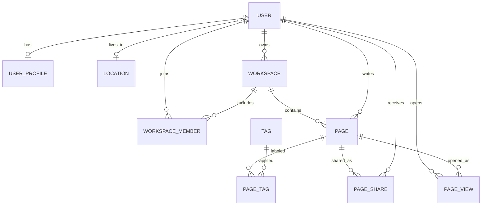

# NoteKeeper: assessment guide

This guide answers each point of the Web Technology Project instruction, in order, and shows how the points lead into each other. Each answer is short and points to the file that holds the detail.

**The chain in one line:**
problem -> requirements -> domain model -> database schema -> screens -> backend -> two databases -> security -> message broker -> permissions -> Git -> DevOps and tests.

| Step | Instruction point | Takes its input from | Detail file |
| --- | --- | --- | --- |
| 1 | Problem, users, requirements | (start) | `01-problem-and-requirements.md` |
| 2a | ER diagram | the requirements | `../../ERDNotekeeper.png`, `03-physical-schema.md` |
| 2b | Domain concepts | the requirements | `02-domain-model.md` |
| 2c | Technology schema | the domain concepts | `03-physical-schema.md` |
| 3 | Responsive web pages | the user stories | frontend repo, section 3 below |
| 4 | Backend architecture | the schema and the screens | `05-architecture-deep-dive.md` |
| 5 | PostgreSQL and MongoDB | the schema | `03-physical-schema.md`, `05` section 4 |
| 6 | Authentication, OAuth2, performance | the backend | `05` section 7 |
| 7 | RabbitMQ | the backend and the user stories | `05` section 3 |
| 8 | RBAC | authentication (who you are) | `05` section 7.2 |
| 9 | Git | all of the above | section 9 below |
| Bonus | DevOps, tests, new technology | all of the above | sections 10 to 12 |

---

## 1. Problem, users, objectives, scope, requirements

**Problem.** Students and small teams lose notes across chats, files and devices. They need one place to write notes, group them, and share them without giving everyone the same power to edit or delete.

**Solution.** NoteKeeper is a web application that stores notes (pages) in workspaces. The workspace owner decides who can view or edit.

**Target users.**
- A student who writes and organizes personal notes.
- A teammate who is invited to a workspace as a viewer or an editor.
- An administrator who looks after accounts and system settings.

**Objectives.**
- Register, sign in safely, and keep notes in workspaces.
- Share a workspace or a single page with a chosen role.
- Keep operational data in PostgreSQL and document history in MongoDB.
- Send e-mail, SMS and other events through RabbitMQ.

**Scope.**
- In scope: accounts, Google sign-in, two-factor codes, workspaces, pages, tags, sharing, roles, an admin dashboard and settings, "Shared with me", "Recent history", and the Docker stack.
- Out of scope: a paid SMS network (SMS is simulated and stored in the delivery log), offline mode, real-time co-editing.

**Principal functional requirements.**
1. A visitor can register and sign in (password or Google).
2. A person can create workspaces and pages and edit them.
3. An owner can invite a person as VIEWER or EDITOR.
4. A viewer can read and cannot edit. An editor can edit and cannot manage members. Only the owner manages members and deletes the workspace.
5. Every save of a page keeps a copy in MongoDB (Docker stack).
6. Shares, invitations, sign-in codes and password resets are queued on RabbitMQ (Docker stack).
7. An administrator can turn registration, 2FA, e-mail and SMS on or off.

**Measurable quality attributes.**

| Attribute | Target | How it is met or checked |
| --- | --- | --- |
| Usability | Sign-in and lists usable at 375 px width | Tailwind breakpoints, checked in the browser |
| Performance | Lists are paginated; lookups use indexes | Indexes on `owner_id`, `workspace_id`, `user_id`; Spring Data paging |
| Reliability | No lost messages if a consumer is down | Durable RabbitMQ queues with acknowledgements |
| Security | No protected route without a valid token; no access to other people's data | JWT, BCrypt, RBAC, own-data rule, 136-check smoke script |
| Testability | All requirements checkable automatically | Backend and frontend test suites, CI |

**User stories and acceptance criteria.**

*Story 1: Sign in.* As a registered student, I want to sign in so that I can reach my notes.
- An empty username or password shows "Please fill in all fields".
- A signed-out visitor who opens the dashboard is sent to the sign-in page.
- A request to a protected API route without a token is rejected (401).

*Story 2: Write a page.* As a signed-in student, I want to create and edit a page so that my notes are saved.
- After saving, the page is still there after a refresh.
- In the Docker stack, MongoDB stores one revision for each save.
- The editor works in a narrow browser window.

*Story 3: Invite a teammate.* As a workspace owner, I want to invite a person as viewer or editor so that I control what they change.
- A viewer can read and gets 403 when trying to edit.
- An editor can edit a page and cannot manage members.
- The invitation queues an e-mail, an app event, and an SMS if the person has a phone number.

**How this leads on:** the requirements name the things the system must hold (users, workspaces, pages, roles, shares). Section 2 turns those nouns into a model.

---

## 2. Domain and data modeling

### 2a. ER diagram

The diagram is `ERDNotekeeper.png` in the backend repo root. A text version is in `03-physical-schema.md` (Mermaid):



### 2b. Domain concepts (independent of technology)

- **Actors:** Visitor, Member (USER, EDITOR or ADMIN), Workspace owner, Workspace collaborator (OWNER, EDITOR or VIEWER), Administrator.
- **Processes:** register and sign in; create a workspace; write a page; share a page or invite a member; notify the other person; review older copies of a page.
- **Data objects:** User, Profile, Location, Workspace, Membership, Page, Tag, Attachment, Page share, Notification, Page revision, Delivery log.

Full text: `02-domain-model.md`.

### 2c. Technology schema

The model is split by the kind of data:

| Store | Holds | Why |
| --- | --- | --- |
| PostgreSQL | users, workspaces, members, pages, tags, shares, views, settings, notifications | Related data with foreign keys and constraints |
| MongoDB | `page_revisions`, `delivery_logs` | Many separate documents, append-only, no joins needed |

Key constraints (more in `03-physical-schema.md`):
- Primary keys are UUID strings.
- `users.email` and `users.username` are unique.
- `workspaces.owner_id`, `pages.workspace_id`, `pages.user_id` and `workspace_members` ids are foreign keys, with indexes.
- `page_views` has a unique index on (`user_id`, `page_id`).
- MongoDB indexes: `pageId` on `page_revisions`, `channel` on `delivery_logs`.

**How this leads on:** the schema decides what each screen can show and what each API call reads or writes.

---

## 3. Responsive web pages

**Technology:** React 18, react-router, Tailwind CSS, lucide-react icons, dark mode, English/French/Kinyarwanda translations. Repository: `NoteKeeper_Frontend_26026`.

**Main screens:** Login, Register, Verify 2FA, Google callback, Dashboard (admins also get an overview and Settings tab), Pages, Page editor, Shared with me, Recent history, Archive, Workspaces, Tags, Admin user management, Admin MongoDB data.

**Wireframes** (the layout changes with the screen width):

```
Phone (under 640 px)        Tablet (640-1024 px)        Desktop (over 1024 px)
+----------------+          +-----------------------+   +------+----------------------------+
| = NoteKeeper  o|          | = NoteKeeper       o  |   | Side | NoteKeeper            o    |
+----------------+          +-----------------------+   | bar  +----------------------------+
| [ Search     ] |          | [ Search            ] |   | Dash | [ Search ]  [ + New page ] |
| [ + New page ] |          | +--------+ +--------+ |   | Page |  +------+ +------+ +-----+ |
| +------------+ |          | | Page A | | Page B | |   | Work |  |Page A| |Page B| |Page | |
| | Page A     | |          | +--------+ +--------+ |   | Tags |  +------+ +------+ +-----+ |
| +------------+ |          | | Page C | | Page D | |   | Share|  |Page D| |Page E| |Page | |
| | Page B     | |          | +--------+ +--------+ |   | Admin|  +------+ +------+ +-----+ |
| +------------+ |          +-----------------------+   +------+----------------------------+
+----------------+          menu in a drawer            fixed sidebar, 3-column grid
menu in a drawer, 1 column
```

How adaptability is done: Tailwind responsive classes (`sm:`, `md:`, `lg:`) on the layout and grids, a sidebar that becomes a drawer on small screens, and tables that scroll sideways instead of overflowing.

**Screens by role:**
- Everyone: Dashboard, Pages, Workspaces, Shared with me, Recent history.
- Viewer inside a workspace: the editor opens read-only.
- Admin: also the system overview, Settings tab, user management, the Mine/Everyone switch, and the MongoDB data screen.

**How this leads on:** each screen calls the API in `src/api/endpoints.js`. Section 4 is the other side of those calls.

---

## 4. Backend architecture

**Style:** a layered monolith with event-driven messaging for notifications.

**Technology:** Spring Boot 3.5, Java 17, Spring Security, Spring Data JPA, Spring Data MongoDB, Spring AMQP.

```
React -> axios (adds the JWT) -> JwtAuthenticationFilter -> SecurityConfig URL rules
      -> Controller -> Service (PermissionService) -> Repository -> database
      -> GlobalExceptionHandler turns errors into JSON (400 / 401 / 403 / 404 / 409)
```

Layers: `controller` (13 REST controllers), `service` (business rules), `repository` (JPA and Mongo), `model` and `document` (entities), `dto` and `mapper` (response shapes), `security`, `messaging`, `exception`, `config`.

**Run modes.**

| Mode | Command | RabbitMQ and MongoDB |
| --- | --- | --- |
| Local | `mvn spring-boot:run` | Not used. E-mail is sent directly. |
| Docker | `docker compose up -d --build` | Used. Profile `docker` switches to the RabbitMQ publisher and the Mongo recorder. |

Why it is built this way: `@Profile("docker")` strategy pairs let one code base run with or without the extra services. The services call an interface (`EventPublisher`, `PageRevisionRecorder`) and do not know which one is active.

Detail: `05-architecture-deep-dive.md` sections 1, 2 and 6.

---

## 5. Relational and non-relational databases

| Data | Store | Written when |
| --- | --- | --- |
| Users, workspaces, members, pages, tags, shares, views, settings, notifications | PostgreSQL | Every normal action |
| Page revisions | MongoDB `page_revisions` | Every page save: create, quick note, update (Docker stack) |
| Delivery log (e-mail, SMS, app events) | MongoDB `delivery_logs` | When a RabbitMQ consumer handles a message (Docker stack) |

- **Page revisions** are full snapshots (title, content, author, time) of one page, kept as separate documents. This is document-shaped, append-only data with no joins, which suits MongoDB.
- **Delivery logs** are different records for different channels, so a flexible schema is a good fit.
- **How to see it:** admin screen **MongoDB Data**, or mongo-express at http://localhost:8081, or Compass at `mongodb://127.0.0.1:27017` (use `127.0.0.1`, not `localhost`, on Windows).
- **Known limit:** PostgreSQL and MongoDB are written separately, so a failure between them can leave an orphan revision.

Detail: `05` sections 4 and 5.

---

## 6. Authentication, OAuth2 and performance

**Authentication**
- Passwords are hashed with BCrypt.
- Login returns a JWT (HS256, 10 hours). Sessions are stateless.
- **Two-factor:** a 6-digit code is created at login and e-mailed through RabbitMQ. The user enters it at `/api/auth/verify-2fa`. An admin can switch 2FA off. For development the PIN is also printed to the server console as `[2FA] PIN for <email>: 123456`. It never appears in an HTTP response or the UI.
- **Password reset:** a one-hour token is e-mailed as a link.

**OAuth2 (Google, authorization-code flow)**
1. The browser goes to Google's consent page (`GoogleSignIn.jsx`).
2. Google redirects back to `/auth/google/callback` with a one-time `code`.
3. The frontend posts the code to `POST /api/auth/google-callback`.
4. The backend exchanges the code for a token and reads the profile (e-mail and name) from Google. The client secret stays on the server.
5. The user is found or created, then goes through the same 2FA step.

The older mock endpoint `POST /api/auth/google-login` was removed because it did not verify a Google token.

**Performance**
- List endpoints use Spring Data paging.
- Foreign-key columns used in permission checks and lists are indexed.
- Notifications are sent asynchronously through RabbitMQ, so the HTTP request does not wait for Gmail.
- The Recent history list uses an index on (`user_id`, `last_viewed_at`).

---

## 7. RabbitMQ: e-mail, SMS and other events

Three durable queues, created by the `RabbitAdmin` bean in `DockerInfrastructureConfig`:

| Queue | Message | Consumer (`QueueListeners`) | Ends at |
| --- | --- | --- | --- |
| `email` | recipient, subject, body | Sends it through Gmail SMTP, then logs the subject | A real inbox, plus MongoDB |
| `sms` | phone number, text | Records it | MongoDB (SMS is simulated) |
| `app-events` | event name, details | Records it | MongoDB, as an audit trail |

**What publishes a message**

| Action | `email` | `sms` | `app-events` |
| --- | --- | --- | --- |
| Login with 2FA, Google sign-in | yes | no | no |
| Password reset | yes | no | no |
| Page share | yes | if the person has a phone | yes |
| Workspace invitation | yes | if the person has a phone | yes |
| Added to a workspace | yes | if the person has a phone | yes |

- No SMS is queued when the phone number is blank, or when the admin switches SMS off.
- E-mail and RabbitMQ do not conflict: RabbitMQ carries the message, SMTP delivers it. The queue means the web request returns at once.
- **Where to look:** RabbitMQ UI http://localhost:15672 (`guest` / `guest`), Queues tab (each queue has 1 consumer and Ready is normally 0), and the admin **MongoDB Data** screen, Delivery log tab.
- **Known limits:** SMS is simulated (a real text needs a paid provider), and there is no dead-letter queue.

Detail: `05` section 3.

---

## 8. Authorization (RBAC)

Two levels, enforced on the server:

1. **System role** (`USER`, `EDITOR`, `ADMIN`) in `SecurityConfig`. Examples: `/api/admin/**` is admin only; system-wide page and workspace lists are admin only; a public sign-up cannot choose its own role.
2. **Resource role** in `PermissionService`:

| Role | Read | Edit page | Manage members | Delete workspace |
| --- | --- | --- | --- | --- |
| OWNER | yes | yes | yes | yes |
| EDITOR | yes | yes | no | no |
| VIEWER | yes | no | no | no |
| ADMIN (system) | yes | no (never edits another person's page) | admin tools only | admin tools only |

3. **Own-data rule:** `OwnDataInterceptor` rejects any request to a `{userId}` or `{ownerId}` route unless the caller is that user or an admin (403).

The frontend mirrors this (read-only editor for viewers, `AdminRoute` for admin screens), but the real checks are in the API.

**How it follows from step 6:** authentication proves who you are (the JWT). Authorization decides what that person may do.

---

## 9. Git

- Two repositories: `NoteKeeper_26026` (backend) and `NoteKeeper_Frontend_26026` (frontend).
- Work is done on the branch `feature/unified-dashboard-sharing`, with one commit per change area (see section 13).
- Finish with a pull request into `main` on each repository.
- Commit messages follow `type(scope): what and why`, with the types `feat`, `fix`, `test`, `docs`, `chore`, `build`.

---

## 10. Bonus: DevOps

- `docker-compose.yml`: PostgreSQL 16, MongoDB 7, mongo-express, RabbitMQ with the management UI, the backend and the frontend, with health checks and start order (`depends_on`).
- A multi-stage `Dockerfile` for the backend (Maven build, then a JRE 17 image) and one for the frontend.
- Secrets come from `.env` (not committed). `.env.example` shows the names.
- CI: `.github/workflows/tests.yml` runs `mvn -q test` on every push and pull request.
- Scripts: `scripts/seed-demo-data.ps1` (demo data), `scripts/set-demo-phone.ps1` (gives every user a demo phone number), `scripts/docker-smoke.ps1` (136 checks against the live stack).

Run it:

```powershell
docker compose up -d --build
.\scripts\seed-demo-data.ps1
.\scripts\docker-smoke.ps1
```

---

## 11. Bonus: Testing and quality assurance

| Level | What | Where |
| --- | --- | --- |
| Unit | Role rules, message shape, queue consumers, publisher, infrastructure beans | `PermissionServiceTest`, `OutboundMessageServiceTest`, `QueueListenersTest`, `RabbitEventPublisherTest`, `DockerInfrastructureConfigTest` |
| Integration (MockMvc, H2) | Whole API as anonymous, member and admin; two real users sharing a workspace | `EndpointSmokeTest`, `SharingAndSettingsIntegrationTest`, `ProtectedResourceSecurityTest` |
| Frontend | Login validation, route guards, dashboard roles, scope toggle, shared and recent screens, MongoDB data screen (33 tests) | `src/**/*.test.js` |
| Live stack | Every endpoint, with RBAC and edge cases (136 checks, exit code 1 on failure) | `scripts/docker-smoke.ps1` |

Run: `mvn test` (backend), `npm test` (frontend).

---

## 12. Bonus: New technology explored

- **RabbitMQ** with Spring AMQP (event-driven notifications).
- **MongoDB** with Spring Data MongoDB (revision history).
- **Google OAuth2** authorization-code flow.
- **Two-factor sign-in** by e-mail code.
- **Docker Compose** with health checks, plus mongo-express.
- **lucide-react** icon set and a dark-mode design system.

---

## 13. Commit plan

The exact commands are in `commit-all.ps1` (run it from the `Notekeeper` folder). Summary:

**Backend (`NoteKeeper_26026`)**

1. `chore: ignore uploads folder and add .env.example`
2. `fix(api): return proper 400/403/409/413 instead of 500 for framework errors`
3. `fix(security): own-data rule for userId/ownerId routes; lock down user endpoints; remove mock google-login; stop logging password hashes; print 2FA PIN as a plain console line`
4. `fix(attachments,shares): return DTOs, enforce page permissions, restrict download-by-path to uploads/`
5. `fix(docker): declare RabbitAdmin so the queues exist; pass SMTP and secrets from .env; wait for healthy services`
6. `feat(mongo): admin read API for page revisions and delivery log; log e-mail deliveries`
7. `test: add end-to-end endpoint smoke test covering auth, RBAC, MongoDB read API and edge cases`
8. `chore(scripts): add demo data seeder, demo phone setter and Docker endpoint smoke script`
9. `docs: add assessment guide and architecture deep dive; document MongoDB screen, e-mail delivery log and Docker setup`

**Frontend (`NoteKeeper_Frontend_26026`)**

1. `feat(dashboard): merge admin dashboard into /dashboard; add admin MongoDB data screen`
2. `feat(pages): add admin Mine/Everyone scope toggle to pages and workspaces`
3. `feat(pages): add Shared with me and Recent history`
4. `feat(sharing): workspace sharing with owner/editor/viewer roles; read-only editor for viewers`
5. `feat(ui): switch to lucide-react icons and refresh the look (gradients, hover effects, dark mode)`

Then push each branch and open a pull request into `main`.

